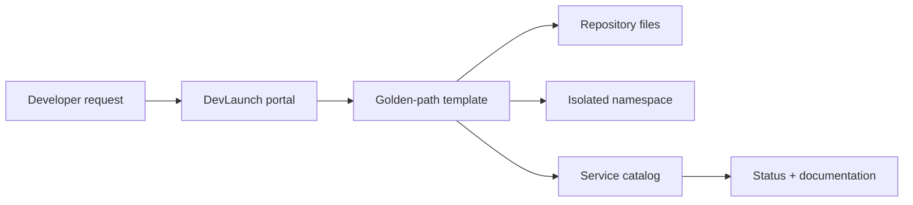

# DevLaunch

A self-service internal developer platform that turns a service request into a documented, deployable golden path with an isolated environment plan and catalog entry.



## Included platform capabilities

- DNS-safe service validation and collision protection
- Python service, Docker, Kubernetes, ownership, health, and documentation templates
- Namespace-per-service environment plan with default-deny networking intent
- Persistent service catalog with owner, repository, docs, environment, and health status
- CLI and FastAPI portal adapter
- Benchmark for median and p95 onboarding plus environment setup time

### Measured onboarding benchmark

| Signal | Result |
| --- | ---: |
| Services scaffolded | 25 |
| Median onboarding | 1.260 ms |
| p95 onboarding | 1.452 ms |
| Median environment plan | 0.050 ms |
| Test coverage | 97.65% |

The benchmark measures local template rendering and catalog provisioning on one development machine. The committed [result](benchmarks/results.json) keeps the claim inspectable.

## Quickstart

```bash
python -m venv .venv
source .venv/bin/activate
pip install -e '.[dev,api]'
devlaunch orders-api --owner payments-team
devlaunch-benchmark
pytest
uvicorn devlaunch.api:app --reload
```

The generated output is explicit and reviewable; DevLaunch does not silently apply infrastructure or overwrite an existing service.
